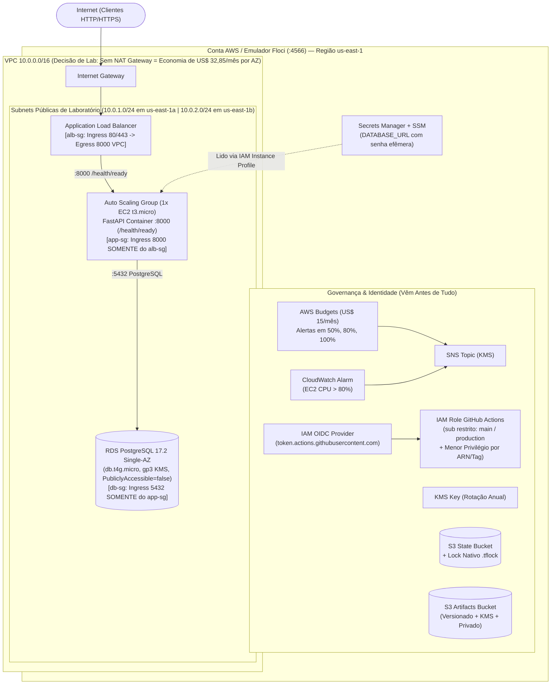
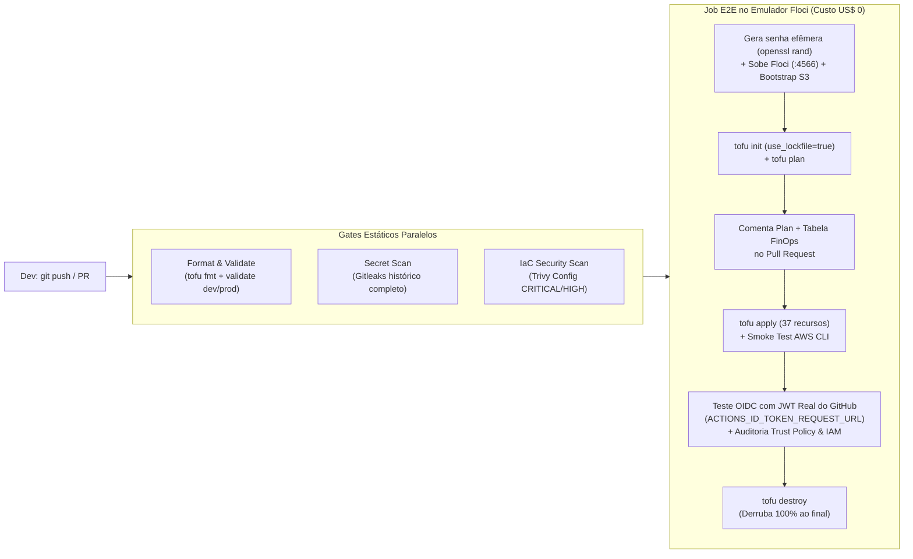
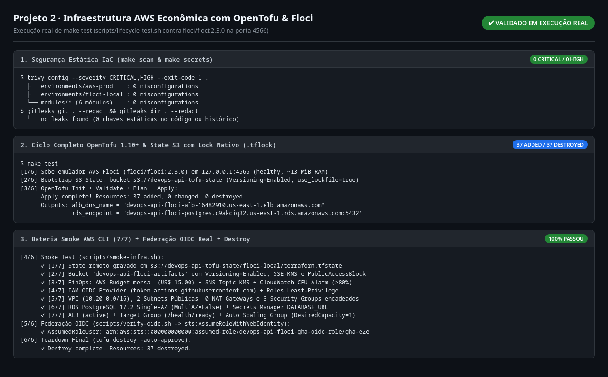
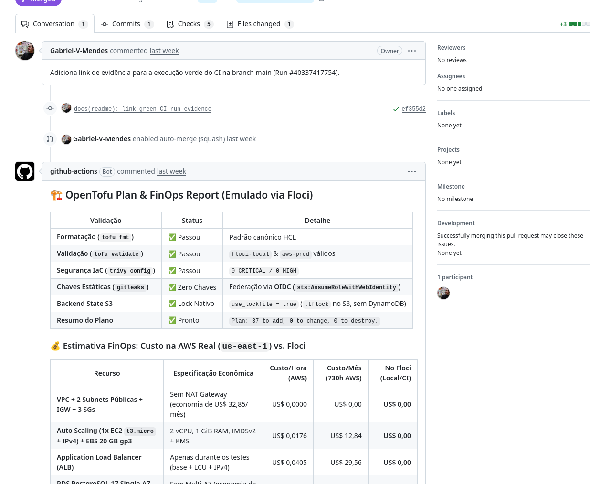

# Infraestrutura AWS Econômica com OpenTofu & Floci (CI/CD + OIDC + FinOps)

[](https://github.com/Gabriel-V-Mendes/infraestrutura-aws-opentofu-floci/actions/workflows/infra-ci.yml)

Infraestrutura na AWS declarada em **OpenTofu (1.10+)** com arquitetura enxuta voltada a **FinOps**, **Zero Chaves Estáticas (GitHub Actions OIDC com `sub` restrito e menor privilégio)**, **State em S3 com Lock Nativo (`use_lockfile = true`)**, validação DevSecOps com **Trivy Config / Checkov** e emulação local 100% open-source via **[Floci (`floci-io/floci`)](https://github.com/floci-io/floci)**.

---

## 1. Problema

A primeira versão deste repositório (`commit dd249e2`) tentava demonstrar uma arquitetura 3-Tier com Terraform, mas apresentava problemas estruturais de custo, segurança e automação:

| Sintoma na versão antiga (`dd249e2`) | Consequência prática |
|---|---|
| Os arquivos foram commitados dentro de `Documentos/Infraestrutura_aws_terraform/` e `.github/workflows/terraform.yml` tinha **0 bytes** | O pipeline do GitHub Actions **nunca executava** |
| `variables.tf` e `outputs.tf` da raiz estavam com **0 bytes** | A infraestrutura não expunha endpoints nem aceitava parametrização por ambiente |
| `modules/networking` provisionava **NAT Gateway (`aws_nat_gateway`) + Elastic IP** | Custo fixo de **~US$ 32,85/mês** (+ tráfego por GB) na AWS real mesmo com zero requisições |
| `modules/database` criava uma `aws_instance.postgres_mock` (EC2 comum) em vez de `aws_db_instance` | Não declarava um banco gerenciado RDS real com Subnet Group, KMS e Secrets Manager |
| `provider.tf` e `backend.tf` tinham `access_key = "test"` e `secret_key = "test"` chumbados no código | Hábito inseguro de credenciais estáticas no HCL; sem federação OIDC |
| `backend-setup/main.tf` criava tabela **DynamoDB** para state lock mesmo usando `use_lockfile = true` | Recurso redundante: o OpenTofu/Terraform 1.10+ faz lock nativo direto no S3 via `.tflock` |
| Instâncias sem IMDSv2 (`http_tokens = "required"`), EBS sem criptografia e SGs com egress `0.0.0.0/0` irrestrito | **21 falhas** no `trivy config` (2 CRITICAL, 11 HIGH) |
| Não havia orçamento (`aws_budgets_budget`), alertas SNS/CloudWatch, ALB nem Auto Scaling | Desenho incompleto e sem governança financeira (FinOps) |
| Dependência do `localstack/localstack` sem token | A partir de março de 2026 (`2026.03.0`), a imagem unificada do LocalStack passou a exigir token de autenticação obrigatório (`LOCALSTACK_AUTH_TOKEN`) |

**Objetivo:** reestruturar o projeto de ponta a ponta com **OpenTofu** e **Floci**, aplicando o desenho econômico de laboratório (sem NAT Gateway e com RDS Single-AZ), orçamento/alertas antes de tudo, autenticação sem chaves estáticas via **OIDC** (restrita a `ref:refs/heads/main` e `environment:production`), permissões IAM de menor privilégio (sem `ec2:*`, `rds:*`, `kms:*` ou `secretsmanager:*`), senhas geradas dinamicamente por execução e ciclo completo (`init` → `plan` → `apply` → `smoke` → `OIDC` → `destroy`) validado automaticamente a cada Pull Request.

**Critérios de pronto:**
- [x] `destroy` e `apply` do zero funcionam com um único comando (`make test`) e rodam a cada push/PR no GitHub Actions.
- [x] O resultado do `tofu plan` + tabela FinOps aparecem comentados automaticamente no Pull Request.
- [x] Não existe nenhuma chave de acesso estática nem senha fixa no código ou histórico (`gitleaks` verde + senhas geradas por execução via `openssl rand -hex 16`).
- [x] Trust policy do OIDC restrita exclusivamente a `ref:refs/heads/main` e `environment:production` (sem `repo:...:*`) e Role IAM sem curingas amplos (`ec2:*`, `rds:*`, `kms:*`, `secretsmanager:*`), com ações listadas e limitadas por ARN ou tag.
- [x] Cada `trivy:ignore` e `checkov:skip` possui justificativa técnica escrita no código e documentada na [§4.4](#44-segurança-estática-trivy-config--checkov-e-justificativa-de-cada-exceção).

---

## 2. Arquitetura

### 2.1 Topologia Econômica de Laboratório (Sem NAT Gateway, SGs Estritos em 3 Camadas)



> [!IMPORTANT]
> **Decisão explícita de laboratório (Banco em Subnet Pública com `PubliclyAccessible = false`):**
> Neste projeto de laboratório, o `aws_db_subnet_group` utiliza as duas subnets públicas para demonstrar uma topologia enxuta **sem NAT Gateway** (economizando ~US$ 32,85/mês por AZ). Mesmo nessas subnets, o RDS tem `publicly_accessible = false` (não recebe IP público) e o `db-sg` aceita conexões na porta `5432` exclusivamente a partir do `app-sg`. **Em produção real**, o RDS ficaria obrigatoriamente em **subnets privadas isoladas** (sem rota para o Internet Gateway) — veja os detalhes completos na [§8 (Decisões e Trade-offs)](#8-decisões-e-trade-offs).

### 2.2 Pipeline CI/CD & DevSecOps (`.github/workflows/infra-ci.yml`)



### 2.3 Estrutura Modular do Repositório

```text
.
├── docker-compose.yml               # Emulador AWS Floci (floci/floci:2.3.0 fixado por digest SHA256)
├── Makefile                         # Atalhos (gera TF_VAR_db_password efêmera por execução via openssl rand)
├── modules/                         # Módulos reutilizáveis e agnósticos de ambiente
│   ├── budget-alerts/               # 1. Orçamento (AWS Budgets), SNS criptografado e CloudWatch Alarm
│   ├── iam-oidc/                    # 2. OIDC Provider (sub restrito a main/production) + Role sem curingas + EC2 Profile
│   ├── storage/                     # 3. KMS Key + Bucket S3 versionado, criptografado e privado
│   ├── network/                     # 4. VPC, IGW, 2 Subnets Públicas (sem NAT) e 3 Security Groups estritos
│   ├── database/                    # 5. RDS PostgreSQL 17.2 Single-AZ + Secrets Manager + SSM Parameter
│   └── compute/                     # 6. ALB (/health/ready), Target Group, Launch Template (IMDSv2) e ASG (1x EC2)
├── environments/                    # Separação por diretórios de ambiente
│   ├── floci-local/                 # Ambiente local e CI apontando para Floci (http://localhost:4566)
│   └── aws-prod/                    # Ambiente AWS Real autenticado via OIDC (sem override de endpoints)
├── scripts/
│   ├── bootstrap-state.sh           # Inicializa o bucket S3 de state versionado
│   ├── smoke-infra.sh               # Verifica os 37 recursos provisionados via AWS CLI
│   ├── verify-oidc.sh               # Requisita JWT OIDC real no GitHub Actions, audita IAM e valida AssumeRoleWithWebIdentity
│   ├── lifecycle-test.sh            # Orquestra init -> validate -> plan -> apply -> smoke -> OIDC -> destroy
│   └── protect-main.sh              # Ativa branch protection exigindo os 4 checks verdes na main
└── .github/workflows/infra-ci.yml   # Pipeline declarativo completo com PR Plan Comment e job AWS Real parametrizado
```

### 2.4 Inventário dos 37 Recursos Provisionados (6 Módulos)

| Módulo | Qtd | Recursos Gerenciados (`tofu state list`) | Função Principal |
|---|:---:|---|---|
| [`modules/budget-alerts`](modules/budget-alerts/main.tf) | **4** | `aws_budgets_budget.monthly_cost`, `aws_sns_topic.alerts`, `aws_sns_topic_subscription.email[0]`, `aws_cloudwatch_metric_alarm.cpu_high` | Orçamento mensal (US$ 15) com alertas em 50%/80%/100% (atual e previsto) e alarme de CPU > 80% |
| [`modules/iam-oidc`](modules/iam-oidc/main.tf) | **6** | `aws_iam_openid_connect_provider.github_actions`, `aws_iam_role.github_actions_oidc`, `aws_iam_role_policy.github_actions_iac`, `aws_iam_role.ec2_app`, `aws_iam_role_policy.ec2_app_least_privilege`, `aws_iam_instance_profile.ec2_app` | Federação OIDC (`sub` restrito a `ref:refs/heads/main` e `environment:production`) e políticas IAM de menor privilégio por ARN e tag |
| [`modules/storage`](modules/storage/main.tf) | **7** | `aws_kms_key.main`, `aws_kms_alias.main`, `aws_s3_bucket.artifacts`, `aws_s3_bucket_versioning.artifacts`, `aws_s3_bucket_server_side_encryption_configuration.artifacts`, `aws_s3_bucket_public_access_block.artifacts`, `aws_s3_bucket_lifecycle_configuration.artifacts` | Chave KMS com rotação anual + Bucket S3 versionado, criptografado (`aws:kms`), 100% privado e com regra de lifecycle |
| [`modules/network`](modules/network/main.tf) | **10** | `aws_vpc.main`, `aws_internet_gateway.main`, `aws_subnet.public[0..1]`, `aws_route_table.public`, `aws_route_table_association.public[0..1]`, `aws_security_group.alb`, `aws_security_group.app`, `aws_security_group.db` | VPC (`10.0.0.0/16`), 2 Subnets Públicas Multi-AZ (**0 NAT Gateways**) e 3 Security Groups encadeados |
| [`modules/database`](modules/database/main.tf) | **5** | `aws_db_subnet_group.main`, `aws_db_instance.postgres`, `aws_secretsmanager_secret.database_url`, `aws_secretsmanager_secret_version.database_url`, `aws_ssm_parameter.db_endpoint` | RDS PostgreSQL Single-AZ (`db.t4g.micro`, `gp3` KMS, `publicly_accessible = false`) + `DATABASE_URL` no Secrets Manager |
| [`modules/compute`](modules/compute/main.tf) | **5** | `aws_lb.app`, `aws_lb_target_group.app`, `aws_lb_listener.http`, `aws_launch_template.app`, `aws_autoscaling_group.app` | Application Load Balancer, Target Group (`/health/ready`), Launch Template (`t3.micro`, IMDSv2 obrigatório, EBS KMS) e ASG (1 instância) |
| **Total** | **37** | **0 chaves estáticas · 0 senhas fixas · 0 NAT Gateways · 0 tabelas DynamoDB** | **Stack completa reproduzível do zero** |

---

## 3. Subir e testar tudo com um comando

Pré-requisitos: Docker (com Compose v2), OpenTofu (`>= 1.10`), AWS CLI v2, `jq`, `openssl`, `trivy` e `gitleaks`.

```bash
make test     # Sobe o Floci, gera senha efêmera e executa: bootstrap S3 -> init -> validate -> plan -> apply -> smoke -> OIDC -> destroy
```

Se quiser inspecionar os recursos ativos antes de destruir:

```bash
make up       # Sobe o Floci em background (~3s) na porta 127.0.0.1:4566
make apply    # Inicializa o backend S3 com lock nativo e provisiona os 37 recursos
make smoke    # Executa 7 baterias de verificação via AWS CLI contra o Floci
make oidc     # Audita Trust Policy/IAM e testa sts:AssumeRoleWithWebIdentity
make destroy  # Derruba todos os 37 recursos ao final
make down     # Desliga o container do Floci e remove o volume temporário
```

### 3.1 Resultado Real da Suíte de Validação (`make scan secrets test down`)

Saída verificada localmente e no GitHub Actions:

```text
1. make scan (trivy config --severity CRITICAL,HIGH --exit-code 1 .)
   ├── environments/aws-prod    : 0 misconfigurations
   ├── environments/floci-local : 0 misconfigurations
   ├── modules/compute/main.tf  : 0 misconfigurations
   ├── modules/database/main.tf : 0 misconfigurations
   ├── modules/iam-oidc/main.tf : 0 misconfigurations
   ├── modules/network/main.tf  : 0 misconfigurations
   └── modules/storage/main.tf  : 0 misconfigurations

2. make secrets (gitleaks git & dir)
   └── commits & working tree scanned -> no leaks found (0 chaves estáticas e 0 senhas fixas)

3. make test (scripts/lifecycle-test.sh contra floci/floci:2.3.0)
   ├── [Bootstrap] Bucket 'devops-api-tofu-state' pronto para state + lock nativo (.tflock)
   ├── [OpenTofu]  Backend S3 inicializado (use_lockfile = true) + Config validada
   ├── [Apply]     Apply complete! Resources: 37 added, 0 changed, 0 destroyed.
   ├── [Smoke 1/7] State remoto gravado em s3://devops-api-tofu-state/floci-local/terraform.tfstate
   ├── [Smoke 2/7] Bucket S3 'devops-api-floci-artifacts' com Versioning=Enabled e SSE-KMS
   ├── [Smoke 3/7] FinOps: Orçamento mensal ativo (US$ 15.0) + SNS Topic + CloudWatch Alarm
   ├── [Smoke 4/7] IAM OIDC Provider (token.actions.githubusercontent.com) + Roles criadas
   ├── [Smoke 5/7] VPC (10.0.0.0/16), 2 Subnets Públicas, 0 NAT Gateways e 3 SGs estritos
   ├── [Smoke 6/7] RDS PostgreSQL Single-AZ (MultiAZ=False) + Secrets Manager DATABASE_URL
   ├── [Smoke 7/7] ALB (active) + Target Group (/health/ready) + ASG (DesiredCapacity=1)
   ├── [OIDC 1/4]  Trust Policy validada: restrita exclusivamente a ref:refs/heads/main e environment:production
   ├── [OIDC 2/4]  Menor privilégio validado: zero ec2:*, rds:*, kms:* ou secretsmanager:*
   ├── [OIDC 3/4]  Token OIDC obtido (JWT real emitido pelo GitHub Actions no CI)
   ├── [OIDC 4/4]  sts:AssumeRoleWithWebIdentity -> AssumedRoleUser + Temporary AccessKeyId (ASIA***)
   └── [Destroy]   Destroy complete! Resources: 37 destroyed.
```



> [!TIP]
> **Endpoint & Healthcheck da Floci:** Com o emulador rodando (`make up`), consulte o status em `http://localhost:4566/_floci/health` ou inspecione qualquer recurso via `aws --endpoint-url http://localhost:4566 ...`.

---

## 4. O que mudou nesta reformulação (2026)

### 4.1 Mudança de Empacotamento do LocalStack (Março/2026) e Maturidade do Floci

1. **O que realmente mudou no LocalStack em março de 2026 (não foi "descontinuado"):**
   - A partir da release **`2026.03.0` (23 de março de 2026)**, o LocalStack unificou as antigas imagens `localstack/localstack` (Community) e `localstack/localstack-pro` em uma **única imagem Docker (`localstack/localstack`)** que **passou a exigir obrigatoriamente um token de autenticação (`LOCALSTACK_AUTH_TOKEN`)** no startup, mesmo para uso gratuito no plano *Hobby* (fontes oficiais: [LocalStack Blog — *Single Docker Image and Packaging Changes* (03/03/2026)](https://blog.localstack.cloud/2026-03-03-single-docker-image-and-packaging-changes/) e [LocalStack Docs — *Auth Token*](https://docs.localstack.cloud/aws/getting-started/auth-token/)).
   - Em relação aos serviços: enquanto recursos básicos de *EC2 Auto Scaling* fazem parte do tier gratuito autenticado (*Hobby*), provedores avançados de **RDS** e **ELBv2 (ALB)** historicamente exigiram licença paga/Pro no LocalStack ou dependem de validação de conta via `LOCALSTACK_AUTH_TOKEN`.
   - Para que qualquer pessoa (ou runner de CI em fork/PR) possa clonar este repositório e rodar `make test` do zero **sem criar conta externa e sem configurar tokens proprietários**, adotamos o **Floci**.

2. **Por que Floci (`floci-io/floci`) e nota transparente sobre sua maturidade:**
   - **O que é o Floci:** Emulador local open-source (**licença MIT**) para AWS escrito em **Quarkus** e compilado para binário nativo via **GraalVM** (~13 MiB de RAM em repouso e ~24 ms de boot), que responde na porta `4566` sem exigir conta ou token (fontes: [Repositório oficial `floci-io/floci`](https://github.com/floci-io/floci) e [Documentação oficial `floci.io`](https://floci.io/)).
   - **Nota sobre maturidade e limitações do Floci:** O Floci é um projeto recente e em rápida evolução, com maturidade inferior à da AWS real e menor profundidade de simulação que o LocalStack comercial. No pipeline de CI ([`docker-compose.yml`](docker-compose.yml)), utilizamos os modos de control-plane (`FLOCI_SERVICES_EC2_MOCK=true` e `FLOCI_SERVICES_RDS_MOCK=true`) para validar rapidamente contratos de API da AWS, grafo de dependências do OpenTofu, lock de state no S3 e estrutura das políticas IAM/OIDC. **O Floci não substitui testes em conta AWS real** para validar roteamento real de pacotes em Security Groups/ALB, avaliação estrita de condições IAM pelo motor da AWS ou performance de banco de dados.

### 4.2 State em S3 com Lock Nativo (`use_lockfile = true`, sem DynamoDB)
A partir do OpenTofu 1.10 / Terraform 1.10, o backend `s3` suporta **S3 Native State Locking** por meio do atributo `use_lockfile = true` em [`environments/floci-local/backend.hcl`](environments/floci-local/backend.hcl) e [`environments/aws-prod/backend.hcl.example`](environments/aws-prod/backend.hcl.example):
- O OpenTofu cria um arquivo `.tflock` diretamente no bucket S3 usando cabeçalhos de escrita condicional (`If-None-Match: *`).
- **Resultado:** A tabela `aws_dynamodb_table.terraform_locks` que existia na versão antiga foi **100% eliminada**, reduzindo complexidade e superfície de manutenção.

### 4.3 Autenticação OIDC Estrita (`main` / `production`), Menor Privilégio e Zero Senhas Fixas
- **Zero chaves estáticas e zero senhas fixas:** Nenhum arquivo `.tf`, `.hcl`, `Makefile` ou workflow contém `access_key`, `secret_key` ou senha de banco chumbada. A variável `TF_VAR_db_password` é gerada dinamicamente a cada execução (`openssl rand -hex 16`) e mascarada nos logs do GitHub Actions (`::add-mask::`).
- **Trust Policy OIDC estrita (sem `repo:...:*`):** O módulo [`modules/iam-oidc/main.tf`](modules/iam-oidc/main.tf) restringe a condição `token.actions.githubusercontent.com:sub` via `StringEquals` **exclusivamente** a:
  - `repo:Gabriel-V-Mendes/infraestrutura-aws-opentofu-floci:ref:refs/heads/main`
  - `repo:Gabriel-V-Mendes/infraestrutura-aws-opentofu-floci:environment:production`
  Qualquer branch de feature ou Pull Request não autorizado é bloqueado na própria Trust Policy.
- **Role Policy sem curingas amplos (`ec2:*`, `rds:*`, `kms:*`, `secretsmanager:*` removidos):** As ações da Role `github_actions_iac` em [`modules/iam-oidc/main.tf`](modules/iam-oidc/main.tf) são listadas explicitamente e restritas por ARN do projeto (`arn:aws:rds:...`, `arn:aws:secretsmanager:...`, `arn:aws:ssm:...`, `arn:aws:sns:...`, `arn:aws:cloudwatch:...`, `arn:aws:budgets:...`, `var.kms_key_arn`, `arn:aws:elasticloadbalancing:...`, `arn:aws:autoscaling:...`) ou pelas tags `aws:ResourceTag/Environment` e `aws:RequestTag/Environment`.
- **Teste OIDC com Token Real no GitHub Actions:** Quando executado no GitHub Actions (`permissions: id-token: write`), o script [`scripts/verify-oidc.sh`](scripts/verify-oidc.sh) requisita um **JWT OIDC real assinado pelo provedor `https://token.actions.githubusercontent.com`** (via `ACTIONS_ID_TOKEN_REQUEST_URL&audience=sts.amazonaws.com`) e valida tanto os claims reais do token quanto a chamada `sts:AssumeRoleWithWebIdentity`.

### 4.4 Segurança Estática (`Trivy Config` & `Checkov`) e Justificativa de Cada Exceção

```bash
make scan     # trivy config --severity CRITICAL,HIGH --exit-code 1 .
make checkov  # checkov -d . --framework terraform --quiet --compact
make secrets  # gitleaks git & dir
```

Todas as 6 regras `# trivy:ignore` e os `# checkov:skip` restantes no código possuem justificativa técnica explícita nos próprios arquivos `.tf` e estão consolidados abaixo:

| Arquivo | Regra Ignorada (`Trivy` / `Checkov`) | Recurso | Justificativa Técnica Escrita (Lab vs. Produção) |
|---|---|---|---|
| [`modules/iam-oidc/main.tf`](modules/iam-oidc/main.tf) | `AVD-AWS-0057`, `CKV_AWS_290`, `CKV_AWS_355` | `aws_iam_role_policy.github_actions_iac` | As ações de escrita em RDS, KMS, Secrets Manager, SSM, S3, SNS, CloudWatch, Budgets, ALB e ASG estão **listadas explicitamente e restritas por ARN ou tag**. Apenas as chamadas de leitura (`ec2:Describe*`, `elasticloadbalancing:Describe*`, `autoscaling:Describe*`, `kms:ListAliases`) e as ações de criação inicial cujo ARN é gerado pela AWS no ato da chamada (`ec2:CreateVpc`, `ec2:CreateSubnet`, `ec2:CreateSecurityGroup`, `kms:CreateKey` — condicionadas a `aws:RequestTag/Environment`) utilizam `Resource = "*"` por exigência da própria API AWS. |
| [`modules/storage/main.tf`](modules/storage/main.tf) | `AVD-AWS-0089`, `CKV_AWS_18`, `CKV_AWS_144`, `CKV2_AWS_62` | `aws_s3_bucket.artifacts` | *Access logging* S3, replicação *cross-region* e *event notifications* foram omitidos por decisão FinOps para não criar um segundo bucket recursivo de logs nem dobrar custos de storage entre regiões no laboratório. Em produção, a auditoria de objetos é feita via **AWS CloudTrail Data Events**. |
| [`modules/network/main.tf`](modules/network/main.tf) | `AVD-AWS-0178`, `CKV2_AWS_11`, `CKV2_AWS_12` | `aws_vpc.main` | *VPC Flow Logs* omitidos por padrão para evitar custo contínuo de ingestão no CloudWatch Logs durante testes. O *Default Security Group* da VPC não é utilizado por nenhum recurso; o isolamento real é aplicado pelos 3 Security Groups dedicados (`alb`, `app`, `db`). |
| [`modules/network/main.tf`](modules/network/main.tf) | `AVD-AWS-0107`, `CKV_AWS_260` | `aws_security_group.alb` | O Application Load Balancer é a borda pública da aplicação e precisa aceitar tráfego HTTP/HTTPS (`80`/`443`) dos clientes externos (`var.allowed_ingress_cidrs`), encaminhando-o exclusivamente para a porta `8000` da VPC. |
| [`modules/network/main.tf`](modules/network/main.tf) | `AVD-AWS-0104`, `CKV_AWS_382` | `aws_security_group.app`, `aws_launch_template.app` (`CKV_AWS_88`) | Como a topologia de laboratório elimina o NAT Gateway (~US$ 32,85/mês por AZ), a instância EC2 da API recebe IP público e permissão de saída `TCP 443` (`0.0.0.0/0`) apenas para baixar a imagem Docker do GHCR e acessar Secrets Manager/SSM. O tráfego de entrada continua 100% bloqueado para a internet (aceita apenas porta `8000` vinda do `alb-sg`). |
| [`modules/database/main.tf`](modules/database/main.tf) | `CKV_AWS_157`, `CKV_AWS_118`, `CKV_AWS_293`, `CKV_AWS_354`, `CKV2_AWS_57` | `aws_db_instance.postgres`, `aws_secretsmanager_secret.database_url` | `multi_az = false`, `deletion_protection = false`, ausência de *Enhanced Monitoring* pago e ausência de Lambda de rotação automática são escolhas intencionais de laboratório para cortar o custo do RDS pela metade e permitir `tofu destroy` automatizado ao fim do teste. |
| [`modules/compute/main.tf`](modules/compute/main.tf) | `AVD-AWS-0053`, `AVD-AWS-0054`, `CKV_AWS_2`, `CKV_AWS_91`, `CKV_AWS_103`, `CKV_AWS_150`, `CKV2_AWS_20`, `CKV2_AWS_28` | `aws_lb.app`, `aws_lb_listener.http` | O ALB é público (`internal = false`) por ser o ponto de entrada da API; opera em HTTP (`80`) no laboratório por não haver domínio Route53/certificado ACM configurado, sem WAFv2 (custo fixo mensal elevado) e com `deletion_protection = false` para permitir `tofu destroy` limpo. |

---

## 5. CI/CD, Comentário do `plan` no PR e Execução na AWS Real

Arquivo: [`.github/workflows/infra-ci.yml`](.github/workflows/infra-ci.yml)

| Job | Quando roda | O que faz | Falha se |
|---|---|---|---|
| **Format & Validate (OpenTofu)** | PR e push | `tofu fmt -check -recursive` + `tofu validate` em `floci-local` e `aws-prod` | Código fora do padrão ou erro de validação |
| **Secret Scan (Gitleaks)** | PR e push | `gitleaks` em todo o histórico (`fetch-depth: 0`) | Qualquer chave estática ou segredo for detectado |
| **IaC Security Scan (Trivy Config)** | PR e push | `trivy config` varrendo todos os módulos e ambientes | Houver qualquer misconfiguration `CRITICAL` ou `HIGH` não justificada |
| **E2E Apply, OIDC & Destroy (Floci)** | Após os 3 acima | Gera senha efêmera → Sobe o Floci → Bootstrap S3 → `tofu init` → `tofu plan` → **Comenta o Plan + Tabela FinOps no PR** → `tofu apply` (37 recursos) → `smoke-infra.sh` → `verify-oidc.sh` (com JWT OIDC real do GitHub Actions) → `tofu destroy` | Qualquer etapa do ciclo de vida, auditoria IAM/OIDC ou smoke test falhar |
| **Deploy & Destroy AWS Real (OIDC Keyless)** | Push na `main` se `AWS_PROD_ENABLED=true` | Solicita JWT OIDC real ao GitHub (`id-token: write`), assume `AWS_OIDC_ROLE_ARN` na AWS real (`aws sts get-caller-identity`), executa `tofu init` + `tofu apply` (com Budgets e Alarmes ativos) e em seguida `tofu destroy` | Falha de federação OIDC ou erro no ciclo `apply`/`destroy` |

* **Evidência do CI (GitHub Actions):**
  [Run #41869803247 no GitHub Actions](https://github.com/Gabriel-V-Mendes/infraestrutura-aws-opentofu-floci/actions/runs/41869803247) (todos os jobs `Format & Validate`, `Secret Scan`, `IaC Security Scan` e `E2E Apply, OIDC & Destroy` aprovados na branch `main`).

### 5.1 Proteção da Branch `main` e Comentário Automático no PR

A branch `main` é protegida via [`scripts/protect-main.sh`](scripts/protect-main.sh) (`make protect-main`), exigindo Pull Request atualizado, histórico linear e os **4 status checks obrigatórios** verdes antes de liberar o merge (inclusive para administradores).

* **Evidência Real de Comentário Automático (`tofu plan` + FinOps) no PR:**
  - **Pull Request:** [PR #9 (`feat: infrastructure modules, Floci local environment, and CI/CD pipeline`)](https://github.com/Gabriel-V-Mendes/infraestrutura-aws-opentofu-floci/pull/9)



### 5.2 Como Executar o Job `aws-prod-oidc` em uma Conta AWS Real

> [!NOTE]
> **Por que a execução em conta AWS real fica parametrizada (`vars.AWS_PROD_ENABLED == 'true'`)?**
> A conta AWS pessoal do autor é antiga (criada antes de julho de 2025) e não é elegível aos créditos do novo AWS Free Tier, de modo que qualquer execução real gera cobrança imediata em cartão. Por transparência técnica e responsabilidade FinOps, não simulamos nem forjamos capturas de cobrança da AWS: deixamos o job `aws-prod-oidc` em [`.github/workflows/infra-ci.yml`](.github/workflows/infra-ci.yml) pronto para assumir a role via OIDC real, aplicar a infraestrutura com `aws_budgets_budget` + alarmes ligados e executar `tofu destroy` imediatamente em seguida assim que uma conta AWS for conectada.

Para executar o ciclo real na sua conta AWS:
1. Crie o provedor OIDC `token.actions.githubusercontent.com` e a role inicial (ou execute o bootstrap uma única vez) confiando em `repo:<seu-usuario>/infraestrutura-aws-opentofu-floci:environment:production`.
2. Em *Settings → Secrets and variables → Actions → Variables*, configure:
   - `AWS_PROD_ENABLED`: `true`
   - `AWS_OIDC_ROLE_ARN`: `arn:aws:iam::<ACCOUNT_ID>:role/devops-api-prod-gha-oidc-role`
   - `AWS_STATE_BUCKET`: nome do bucket S3 de state na sua conta.
3. Faça push na `main` (ou dispare `workflow_dispatch`): o job **`Deploy & Destroy AWS Real (OIDC Keyless)`** assumirá a role via OIDC sem chaves estáticas, provisionará os 37 recursos com orçamento e alarmes ativos e executará `tofu destroy` ao final.

---

## 6. Antes × Depois

Medições realizadas na mesma máquina (Linux x86_64, Docker 29.9, OpenTofu 1.13, Trivy 0.75). **Antes** = commit `dd249e2`; **Depois** = esta versão.

| Métrica / Critério | Antes (`dd249e2`) | Depois (Reformulado) | Δ / Ganho |
|---|---|---|---|
| **Arquivos na raiz correta do repositório** | ❌ Dentro de `Documentos/...` | ✅ Raiz padronizada (`modules/`, `environments/`) | Pipeline CI/CD funcional |
| **Workflow do GitHub Actions** | ❌ 0 bytes (nunca rodou) | ✅ 5 jobs + comentário automático do `plan` no PR | Automação ponta a ponta |
| **Emulador de Nuvem Local** | LocalStack 4.13 (~1 GB imagem, ~143 MiB RAM idle; imagem atual exige `LOCALSTACK_AUTH_TOKEN`) | **Floci 2.3.0** (~90 MB imagem, **~13 MiB RAM idle**, boot ~24 ms, MIT, sem token) | **−91% RAM ociosa** |
| **Misconfigurations no `trivy config`** | **21 falhas** (2 CRITICAL, 11 HIGH, 2 MEDIUM, 6 LOW) | **0 falhas** (0 CRITICAL, 0 HIGH; exceções documentadas) | **−100% misconfigurations** |
| **Chaves estáticas e senhas no código** | ❌ `access_key = "test"` em 3 arquivos | ✅ **0 chaves estáticas e 0 senhas fixas** (OIDC + `openssl rand` por execução) | Elimina anti-pattern de segurança |
| **Escopo da Trust Policy e IAM Role** | Sem OIDC / permissões irrestritas | **`sub` restrito a `main`/`production`** + **ações listadas por ARN/tag** (zero `ec2:*`, `rds:*`, `kms:*`, `secretsmanager:*`) | Menor privilégio real |
| **Lock de State no S3** | Criava tabela DynamoDB redundante | **S3 Lock Nativo (`use_lockfile = true`)** com `.tflock` | Menos 1 serviço para manter |
| **Banco de Dados provisionado** | ❌ `aws_instance` (EC2 vazia fingindo ser banco) | ✅ **`aws_db_instance` RDS PostgreSQL 17.2 Single-AZ** + Secrets Manager | Fidelidade de declaração IaC |
| **Camada de Compute & Rede** | 1 EC2 solta + **NAT Gateway** caro | **ALB (`/health/ready`) + ASG (1x EC2) + 3 SGs estritos**, **sem NAT Gateway** | **−US$ 32,85/mês** por AZ |
| **Governança FinOps (Budgets + Alarmes)** | ❌ Inexistente | ✅ `aws_budgets_budget` + SNS KMS + CloudWatch CPU Alarm | Alertas antes de tudo |

---

## 7. FinOps: Custo por Execução Efêmera (`apply` → `destroy`) vs. Mês Contínuo

Como a infraestrutura é efêmera (provisionada para validação e destruída imediatamente via `tofu destroy`), o indicador financeiro relevante para este laboratório é o **custo por hora / por ciclo de execução** na região `us-east-1` (N. Virginia, preços On-Demand consultados em outubro/2026), comparado ao custo caso os recursos fossem esquecidos ligados 24x7 (730h).

### 7.1 Custo por Ciclo de Teste (~15 min), Janela de 10h e Referência de 730h (`us-east-1`)

| Componente | Recurso OpenTofu | Especificação Econômica | Custo por Hora (USD) | Ciclo Rápido `apply -> destroy` (~15 min) | Bateria de 10h de Testes no Mês | Se Esquecido Ligado 730h/Mês | No Floci (Local/CI) |
|---|---|---|---:|---:|---:|---:|---:|
| **Rede (VPC)** | `aws_vpc`, `aws_subnet` (x2), `aws_internet_gateway`, `aws_security_group` (x3) | Subnets públicas + SGs estritos (**Sem NAT Gateway**) | US$ 0,0000 | US$ 0,00 | US$ 0,00 | US$ 0,00 | **US$ 0,00** |
| **Compute (ASG 1x EC2)** | `aws_autoscaling_group` + `aws_launch_template` (`t3.micro` Linux) | 2 vCPU, 1 GiB RAM (`$0.0104/h`) + IPv4 público (`$0.0050/h`) | US$ 0,0154 | < US$ 0,01 | US$ 0,15 | US$ 11,24 | **US$ 0,00** |
| **Disco EC2 (EBS)** | `block_device_mappings` (`20 GB gp3` KMS) | US$ 0,08/GB-mês proporcional ao tempo ativo | US$ 0,0022 | < US$ 0,01 | US$ 0,02 | US$ 1,60 | **US$ 0,00** |
| **Load Balancer (ALB)** | `aws_lb`, `aws_lb_target_group`, `aws_lb_listener` | Base `$0.0225/h` + LCU mínimo `$0.0080/h` + 2 IPv4 públicos (`$0.0100/h`) | US$ 0,0405 | US$ 0,01 | US$ 0,41 | US$ 29,56 | **US$ 0,00** |
| **Banco (RDS Single-AZ)** | `aws_db_instance.postgres` (`db.t4g.micro`, Single-AZ) | Instância `$0.0160/h` + 20 GB gp3 (`$0.115/GB-mês` = `$0.0032/h`) | US$ 0,0192 | < US$ 0,01 | US$ 0,19 | US$ 13,98 | **US$ 0,00** |
| **Segurança & Storage** | `aws_kms_key` (1 CMK), `aws_secretsmanager_secret` (`recovery_window=0`), `aws_s3_bucket` (x2) | KMS `$1.00/mês` (pro-rata até agendar deleção) + Secret `$0.40/mês` (pro-rata) | US$ 0,0021 | ~US$ 0,23* | ~US$ 0,25* | US$ 1,52 | **US$ 0,00** |
| **FinOps & Observabilidade** | `aws_budgets_budget`, `aws_sns_topic`, `aws_cloudwatch_metric_alarm` | 1º Budget grátis, 1 alarme CloudWatch `$0.10/mês` pro-rata | US$ 0,0001 | US$ 0,00 | US$ 0,00 | US$ 0,10 | **US$ 0,00** |
| **TOTAL** | **37 recursos provisionados** | **Arquitetura Econômica Completa** | **US$ 0,0795 / hora** | **≈ US$ 0,02 compute (+ ~US$ 0,23 KMS 7d*)** | **≈ US$ 0,79 (+ ~US$ 0,23 KMS*)** | **US$ 58,00 / mês** | **US$ 0,00** |

*\*Nota sobre o KMS no `destroy`: A AWS exige uma janela mínima de 7 dias (`deletion_window_in_days = 7`) para excluir definitivamente uma CMK (`aws_kms_key`), mas **não cobra** a taxa mensal de US$ 1,00 enquanto a chave está no estado `PendingDeletion` ([AWS KMS Pricing](https://aws.amazon.com/kms/pricing/)).*

### 7.2 Comparativo: Desenho Tradicional Caro vs. Desenho Econômico deste Projeto

| Decisão de Arquitetura | Desenho Tradicional ("Padrão Antigo") | Desenho Econômico (Este Projeto) | Economia por Hora / Mensal (730h) |
|---|---|---|---|
| **Saída de rede das instâncias** | 2x NAT Gateways (Multi-AZ) + 2x EIP (`$0.045/h` cada + IPv4 `$0.005/h`) | **Zero NAT Gateway** (Subnets públicas no lab + SG bloqueando acesso direto à EC2/RDS) | **−US$ 0,1000/h (−US$ 73,00/mês)** |
| **Alta disponibilidade do RDS** | RDS Multi-AZ (`db.t3.small` x2 réplicas + 20 GB) | **RDS Single-AZ** (`db.t4g.micro` Graviton durante os testes) | **−US$ 0,0529/h (−US$ 38,60/mês)** |
| **Instância de Aplicação** | 2x EC2 `t3.small` fixas | **Auto Scaling de 1x `t3.micro` / `t4g.micro`** | **−US$ 0,0264/h (−US$ 19,27/mês)** |
| **Lock do State do Terraform** | Tabela DynamoDB dedicada + KMS | **S3 Lock Nativo (`use_lockfile = true`)** | Simplificação operacional |
| **Taxa Horária / Mensal Contínua** | **US$ 0,2587/h** (**≈ US$ 188,87/mês**) | **US$ 0,0795/h** (**≈ US$ 58,00/mês** se contínuo; **US$ 0,02** num ciclo de 15 min) | **−69% na taxa horária** |

### 7.3 Elegibilidade de RDS e ALB no Plano de Créditos do AWS Free Tier (Documentação Oficial)

Para quem abre uma **nova conta AWS** (modelo *Free Account Plan* lançado pela AWS em julho de 2025):
- A AWS concede **US$ 100 em créditos no cadastro** + até **US$ 100 adicionais** ao completar 5 atividades práticas (incluindo lançar uma instância RDS e configurar o AWS Budgets), totalizando **US$ 200 em créditos válidos por até 6 meses** — fonte oficial: [AWS Free Tier (`https://aws.amazon.com/free/`)](https://aws.amazon.com/free/) e [AWS Billing User Guide — *Using the AWS Free Tier* (`https://docs.aws.amazon.com/awsaccountbilling/latest/aboutv2/free-tier-limits.html`)](https://docs.aws.amazon.com/awsaccountbilling/latest/aboutv2/free-tier-limits.html).
- **Confirmação sobre RDS e ALB:** Tanto o **Amazon RDS** (`db.t4g.micro` / `db.t3.micro` Single-AZ com 20 GB de armazenamento SSD) quanto o **Elastic Load Balancing / Application Load Balancer (ALB)** (750 horas/mês + 15 LCUs) fazem parte dos serviços elegíveis cobertos pelos créditos e franquias do AWS Free Tier, conforme documentado oficialmente em:
  - [Amazon RDS Free Tier (`https://aws.amazon.com/rds/free/`)](https://aws.amazon.com/rds/free/)
  - [Elastic Load Balancing Pricing & Free Tier (`https://aws.amazon.com/elasticloadbalancing/pricing/`)](https://aws.amazon.com/elasticloadbalancing/pricing/)
- **Atenção aos endereços IPv4 públicos:** Mesmo dentro do Free Tier, endereços IPv4 públicos anexados ao ALB e a instâncias EC2 são tarifados à razão de `US$ 0,005/hora` por IPv4 público (abatidos do saldo de créditos de US$ 100–200 nas contas novas, ou cobrados na fatura em contas antigas) — motivo pelo qual configurar o `aws_budgets_budget` antes de tudo e executar `tofu destroy` ao final do teste é indispensável.

---

## 8. Decisões e Trade-offs

| Decisão | Alternativa | Por quê / Trade-off e **O que mudaria em Produção** |
|---|---|---|
| **Banco RDS em subnet pública (`publicly_accessible = false`) sem NAT Gateway** | Subnets privadas isoladas + NAT Gateway | **Decisão exclusiva de laboratório para evitar o NAT Gateway (~US$ 32,85/mês por AZ):** na AWS, uma subnet é chamada de "pública" quando sua Route Table aponta `0.0.0.0/0` para o `igw`. Como o RDS é criado com `publicly_accessible = false` (sem IP público roteável na internet) e o `db-sg` só permite entrada na porta `5432` vinda do `app-sg`, o banco não fica acessível externamente e economizamos o NAT Gateway. **O que mudaria em produção:** em produção real, o banco **nunca** compartilha subnets com recursos públicos; criaríamos **2 subnets privadas isoladas (`10.0.10.0/24` e `10.0.11.0/24`)** cuja Route Table possui **apenas a rota local (`10.0.0.0/16 -> local`)**, sem rota para Internet Gateway nem NAT Gateway, colocando o `aws_db_subnet_group` exclusivamente nelas. Já as instâncias EC2 da aplicação ficariam em subnets privadas de aplicação (`associate_public_ip_address = false`), saindo para o GHCR/AWS APIs via **VPC Endpoints** (`S3` Gateway Endpoint gratuito + Interface Endpoints) ou **NAT Gateway / IPv6 Egress-Only Internet Gateway**. |
| **OpenTofu 1.10+ com `use_lockfile = true`** | Terraform clássico + DynamoDB | 100% open-source (Linux Foundation) e elimina a necessidade de provisionar e manter uma tabela DynamoDB só para travamento de estado. **Em produção:** adicionaríamos o bloco nativo `encryption { key_provider "aws_kms" ... }` do OpenTofu para criptografar o `.tfstate` também no cliente. |
| **Emulador local Floci (`floci/floci:2.3.0`) no CI** | Conta AWS real em todo PR / LocalStack | Não exige conta AWS nem cartão de crédito e roda sem token de autenticação (`LOCALSTACK_AUTH_TOKEN`). Trade-off: menor maturidade e fidelidade de data-plane que a AWS real (ver [§4.1](#41-mudança-de-empacotamento-do-localstack-março2026-e-maturidade-do-floci)). **Em produção:** o Floci é usado como *fast feedback* em PRs, enquanto o job `aws-prod-oidc` aplica em conta AWS real após o merge na `main`. |
| **RDS Single-AZ (`multi_az = false` por padrão)** | RDS Multi-AZ | Corta o custo do banco pela metade nos testes. **O que mudaria em produção:** `multi_az = true`, `deletion_protection = true`, `skip_final_snapshot = false` e rotação automática da senha no Secrets Manager via Lambda. |
| **Autenticação OIDC com `sub` restrito (`main` / `production`) e IAM sem curingas** | `repo:...:*` + `ec2:*` / `rds:*` ou chaves estáticas | Impede que PRs de branches arbitrárias assumam a role na AWS e limita o raio de explosão (*blast radius*) listando ações explícitas por ARN do projeto e tag `Environment`. |
| **Diretórios por ambiente (`environments/floci-local` e `aws-prod`)** | Terraform Workspaces | Isolamento explícito de backend e provedores sem risco de executar `apply` ou `destroy` no workspace errado por engano. |

---

## 9. O que eu faria diferente em produção real de larga escala

1. **Subnets Privadas Isoladas para o RDS + Subnets Privadas para a App com IPv6 Egress-Only IGW / VPC Endpoints:** Separar a VPC em 3 camadas de sub-redes (Pública para o ALB, Privada com saída via IPv6 Egress-Only IGW/VPC Endpoints para a EC2/ECS, e Isolada sem rota externa para o RDS Multi-AZ).
2. **Certificado TLS (ACM) + Redirecionamento HTTP → HTTPS no ALB + AWS WAFv2:** Com um domínio no Route53, substituir o listener HTTP da porta `80` por um redirect `301` para `HTTPS :443` com certificado gerenciado pelo AWS Certificate Manager (ACM).
3. **State Encryption Nativo do OpenTofu (`encryption {}` block):** Criptografar o próprio conteúdo do `.tfstate` usando chave KMS antes mesmo de enviá-lo ao S3.
4. **ECS Fargate Spot ou AWS App Runner:** Para cargas variáveis, substituir o ALB + EC2 por Fargate Spot ou App Runner.

---
